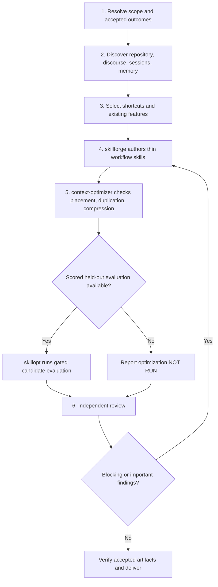

# Skill Bootstrap

> Build the few project workflows that change the next useful action.
> Reuse before you author. Evidence before you write. Report what you did
> not measure.

A **workflow skill** is a short, project-specific route to an accepted
outcome: an accepted fix, a correctly unblocked PR, a verified release
candidate. This skill finds where agents lose time or get corrected in one
repository, then has `skillforge` write the shortcuts. It creates no friction
ledger, registry, or per-fact database. Installing this skill does nothing;
only an explicit request starts a run.

## Triggers

- `bootstrap skills`
- `capture project workflow knowledge`
- `build this repo's skill library`

## When Not To Use

| Request | Route |
|---|---|
| Create or improve one skill | `skillforge` |
| Extract one completed workflow from this session | `skillify`, when installed; else `skillforge` |
| Improve a skill against a scored eval set | `skillopt` |
| Decide placement or compress a skill without an eval | `context-optimizer` |
| Scaffold README or architecture templates | `codebase-documenter` |

## Process



### Phase 1: Resolve scope and accepted outcomes

1. Resolve the repository root, current revision, audience, supported harnesses, and existing skills.
2. Select one output root: `.claude/skills/` or `.github/skills/`. Follow the repository's canonical-source rules when it generates skills from templates.
3. Choose 1 to 3 representative outcomes from real project work. For each, write the observations that prove it meets project standards. A green check or a merged change is an intermediate result, not proof.
4. Respect explicit budgets. Bound discovery to the selected outcomes.
5. Ask at most five questions, and only for facts that evidence cannot supply.
6. Record the boundary before any write:

   ```bash
   python3 "${COPILOT_PLUGIN_ROOT:-${CLAUDE_PLUGIN_ROOT:-.claude}}/skills/skill-bootstrap/scripts/bootstrap_boundary.py" snapshot --repo . --out "<path outside the repo>/snapshot.json"
   ```

**Authority.** Write only inside the selected output root. Keep every other file read-only. Run no mutating git command, deployment, publication, tracker mutation, or platform-setting change. Evaluation grants no extra write authority. Modify an existing skill only when it is inside the boundary and named with `--update`; otherwise compose it or report the proposed change.

### Phase 2: Discover what changes the workflow

Read [references/discovery.md](references/discovery.md). It holds the 16 discovery lenses, the workflow-gap checklist, and the session and memory procedure.

1. Read maintained instructions, skills, contributor guides, build and test entry points, CI, validators, generators, and release definitions.
2. Trace accepted work beside reverts, reopened issues, and stalled branches. Read complete threads. Paginate. Check later corrections before you accept an early diagnosis.
3. Find session sources. For Claude and Copilot, run the `skillopt` source probe: `mine_sessions.py sources`. For other clients, use only a documented export, index, or local store. Never invent a location.
4. Query authorized project memory within scope.
5. Read hosted-platform routing in [references/hosted-platforms.md](references/hosted-platforms.md) when a selected outcome touches PRs, pipelines, trackers, or releases.

**Evidence labels.** Mark each finding as human decision, proposal, bot finding, or measured observation. Mark retrieval you could not complete as `UNAVAILABLE`, never as absence.

### Phase 3: Select shortcuts and existing features

For each outcome, choose one of: reuse an existing skill, improve one inside the boundary, compose existing skills, or create a new workflow skill. Prefer an existing maintained procedure over a copied manual. A lens with no verified friction gets no skill.

Validate names and conflicts before authoring:

```bash
python3 "${COPILOT_PLUGIN_ROOT:-${CLAUDE_PLUGIN_ROOT:-.claude}}/skills/skill-bootstrap/scripts/bootstrap_boundary.py" plan --repo . --output-root .claude/skills --project <project> --name <project>-<lens> [--update <existing-skill>]
```

Exit 1 means a name conflict or invalid name. Rename, add `--update` for an authorized improvement, or drop the skill. Never overwrite blindly.

### Phase 4: Author through skillforge

Invoke `skillforge` once per selected workflow with the brief in [references/authoring-and-gates.md](references/authoring-and-gates.md). Name each output `<project>-<lens>`, for example `snafu-change-control`. The brief requires the first useful action, discriminating observations, decision branches, outcome checks, sibling routes, and a source reference for each surprising instruction. Writing is STE-inspired unless you validated it against the ASD-STE100 dictionary.

### Phase 5: context-optimizer, then skillopt

1. Run `context-optimizer` on each authored skill and its composition. Delete redundant content before you compress. Keep trigger-critical decisions in `SKILL.md`; move conditional detail to `references/`.
2. Run `skillopt` only after step 1 completed, and only when a frozen, scored, held-out evaluation exists. The context-optimized draft is the incumbent.
3. No scored evaluation, or a missing tool: report `skillopt: NOT RUN` with the reason. Never invent an optimization result.

### Phase 6: Review, verify, and deliver

1. Run independent factual, doctrine, and usability reviews on the final workflows. Self-authored approval is not review evidence.
2. Fix blocking and important findings through Phase 4 and Phase 5 again. Recheck the changed workflows and their compositions.
3. Prove the boundary held:

   ```bash
   python3 "${COPILOT_PLUGIN_ROOT:-${CLAUDE_PLUGIN_ROOT:-.claude}}/skills/skill-bootstrap/scripts/bootstrap_boundary.py" verify --repo . --snapshot "<snapshot path>" --output-root .claude/skills --name <each authored or updated skill>
   ```

4. Deliver the report defined in [references/authoring-and-gates.md](references/authoring-and-gates.md#bootstrap-report).

## Scripts

`bootstrap_boundary.py`, in this skill's scripts directory, is stdlib-only and runs on Linux, macOS, and Windows.

| Subcommand | Checks | Exit code 0 | Exit code 1 |
|---|---|---|---|
| `plan` | Output root, `<project>-<lens>` names, existing-skill conflicts | No conflict | Conflict or invalid name |
| `snapshot` | Records HEAD, branch, and hashes of dirty and untracked paths | Written | (not used) |
| `verify` | Changes since the snapshot | All inside named skill directories | A path outside, or HEAD or branch moved |

Exit code 2 is a configuration error, such as a root outside the allowed set or a snapshot inside the repository. Exit code 3 means git is missing or failed. `verify` cannot see changes to gitignored files.

## Anti-Patterns

| Avoid | Instead |
|---|---|
| One skill per lens to fill a quota | Author only where verified friction changes the next action |
| Copying a maintained procedure into a skill | Link to it; add only the hint that prevents a known wrong turn |
| A friction ledger, registry, or per-fact database | Put the lesson in the workflow skill with a source reference |
| Hand-writing skills when `skillforge` is missing | Report the stage as `UNAVAILABLE` and stop authoring |
| Reporting an optimization that never ran | Report `skillopt: NOT RUN` with the missing input |

## Extension Points

Add a discovery lens in `references/discovery.md`. Add a hosting provider section in `references/hosted-platforms.md`. Change the report shape in `references/authoring-and-gates.md`.

## Verification

- [ ] Every selected workflow names an accepted outcome and the observations that prove it.
- [ ] Discovery finished before `skillforge` authored anything.
- [ ] Existing skills were reused or composed before a new one was created.
- [ ] `context-optimizer` ran before `skillopt`, or the report names the skipped stage.
- [ ] Independent factual, doctrine, and usability reviews ran on the final text.
- [ ] `bootstrap_boundary.py verify` exited 0.
- [ ] The report separates authored, evaluated, and installed states, and lists unmeasured results.
