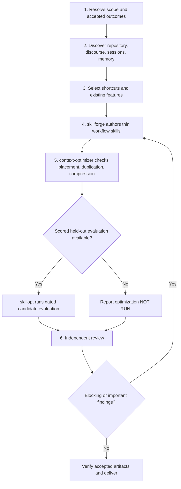

# Skill Bootstrap

> Build the few project workflows that change the next useful action.
> Reuse before you author. Evidence before you write. Report what you did
> not measure.

A **workflow skill** is a short, project-specific route to an accepted
outcome: an accepted fix, a correctly unblocked PR, a verified release
candidate. This skill finds where agents lose time or get corrected in one
repository, then has `skillforge` write the shortcuts. It creates no friction
ledger, registry, or per-fact database. Installing this skill does nothing;
only an explicit request starts a run.

## Triggers

- `bootstrap skills`
- `capture project workflow knowledge`
- `build this repo's skill library`
- `project skill library`

## When Not To Use

| Request | Route |
|---|---|
| Create, improve, or extract one skill | `skillforge` |
| Improve a skill against a scored eval set | `skillopt` |
| Decide placement or compress a skill without an eval | `context-optimizer` |
| Scaffold README or architecture templates | `codebase-documenter` |
| Refresh an existing workflow library | This skill, with each changed skill passed as `--update` |

## Process



In the commands below, `<output-root>` is `.claude/skills` or `.github/skills`. Pass `--name` once per skill. On Windows PowerShell, see [Scripts](#scripts).

### Phase 1: Resolve scope and accepted outcomes

1. **First action:** run `git rev-parse --show-toplevel` and `git rev-parse HEAD`. List the skills under `.claude/skills/` and `.github/skills/`.
2. Find the audience and harnesses from the instruction files present, such as `AGENTS.md`, `CLAUDE.md`, and `.github/copilot-instructions.md`.
3. Select one `<output-root>`. If the repository generates skills from another source, such as a template directory, stop. Ask the user to choose one:
   - authorize the canonical paths, which you then pass to `verify` as `--also-allow <path>`; or
   - receive proposals only, with no skill files written.
4. Choose 1 to 3 accepted outcomes. Ask the user first. If the user has none, pick recent merged changes that took several review rounds, a revert, or a reopened issue. For each outcome, write the observations that prove it meets project standards. A green check or a merged change is an intermediate result, not proof.
5. Respect explicit budgets. Ask at most five questions in total, and only for facts that evidence cannot supply.
6. Record the boundary before any write. Put the snapshot in the system temp directory or a session scratch directory, and keep the same path for Phase 6:

   ```bash
   python3 "${COPILOT_PLUGIN_ROOT:-${CLAUDE_PLUGIN_ROOT:-.claude}}/skills/skill-bootstrap/scripts/bootstrap_boundary.py" snapshot --repo . --output-root <output-root> --out "<snapshot path>"
   ```

**Authority.** Write only inside `<output-root>` and the paths the user authorized in step 3. The snapshot file is the one write outside the repository. Run no mutating git command, deployment, publication, tracker mutation, or platform-setting change. Evaluation grants no extra write authority. Modify an existing skill only when it is inside the boundary and passed with `--update`; otherwise compose it or report the proposed change.

### Phase 2: Discover what changes the workflow

Follow [references/discovery.md](references/discovery.md): repository and discourse, the 16 discovery lenses, workflow gaps, and session and memory sources. When an outcome touches PRs, pipelines, trackers, or releases, also follow [references/hosted-platforms.md](references/hosted-platforms.md). Finish discovery before any authoring.

### Phase 3: Select shortcuts and existing features

Decide per outcome. `skillforge` triage in Phase 4 makes the final call; this choice is the proposal you give it.

| Evidence | Decision | Output |
|---|---|---|
| An existing skill reaches the outcome and no verified friction remains | Reuse | Report row only |
| Verified friction sits inside a skill within the boundary | Improve | `--update <skill>` |
| Two or more skills cover the outcome, but state is lost between them | Compose | One thin `<project>-<lens>` skill that sequences them |
| No skill covers the outcome and friction is verified | Create | One `<project>-<lens>` skill |

A lens with no verified friction gets no skill. Validate names and conflicts before authoring:

```bash
python3 "${COPILOT_PLUGIN_ROOT:-${CLAUDE_PLUGIN_ROOT:-.claude}}/skills/skill-bootstrap/scripts/bootstrap_boundary.py" plan --repo . --output-root <output-root> --project <project> --name <project>-<lens>
```

To improve an existing skill, pass it twice: `--name <skill> --update <skill>`. Exit code 1 means a conflict or an invalid name: rename, get authorization for `--update`, or drop the skill. Never overwrite blindly.

### Phase 4: Author through skillforge

Invoke `skillforge` once per selected workflow with the brief in [references/authoring-and-gates.md](references/authoring-and-gates.md). Run independent workflows in parallel agents when the harness supports it; otherwise run them one at a time. If `skillforge` is unavailable, report `skillforge: UNAVAILABLE` and stop authoring.

### Phase 5: context-optimizer, then skillopt

1. Run `context-optimizer` on each authored skill and its composition. If it is unavailable, report `context-optimizer: UNAVAILABLE` and `skillopt: NOT RUN`.
2. Run `skillopt` only after step 1 completed and only when a frozen, scored, held-out evaluation exists. Otherwise report `skillopt: NOT RUN` with the missing input. Never invent an optimization result.

### Phase 6: Review, verify, and deliver

1. Run the three independent reviews in [references/authoring-and-gates.md](references/authoring-and-gates.md#review). Self-authored approval is not review evidence.
2. Send blocking and important fixes back through Phase 4 and Phase 5.
3. Prove the boundary held, with the same snapshot path:

   ```bash
   python3 "${COPILOT_PLUGIN_ROOT:-${CLAUDE_PLUGIN_ROOT:-.claude}}/skills/skill-bootstrap/scripts/bootstrap_boundary.py" verify --repo . --snapshot "<snapshot path>" --output-root <output-root> --name <new-skill>
   ```

   Add `--update <skill>` for each authorized improvement and `--also-allow <path>` for each path the user authorized in Phase 1.
4. Deliver the report defined in [references/authoring-and-gates.md](references/authoring-and-gates.md#bootstrap-report).

## Scripts

The `bootstrap_boundary.py` script, in this skill's scripts directory, uses only the Python standard library and runs on Linux, macOS, and Windows.

| Subcommand | Checks | Exit code 0 | Exit code 1 |
|---|---|---|---|
| `plan` | Output root, `<project>-<lens>` names, conflicts in both skills roots | No conflict | Conflict or invalid name |
| `snapshot` | Records HEAD, branch, existing skills, and hashes of dirty and untracked paths | Written | (not used) |
| `verify` | Changes since the snapshot; prints the examined path count | All changes authorized | A path outside the boundary, an existing skill changed without `--update`, or HEAD or branch moved |

Exit code 2 is a configuration error: an output root outside the allowed set; an output root, skill directory, or `--also-allow` path that git ignores; an `--also-allow` path outside the repository, under `.git`, or overlapping a skills root; an invalid `--project` or `verify` name; or a snapshot that is inside the repository, unreadable, or from another repository or output root. Exit code 3 means git is missing or failed. `verify` checks the net state of HEAD, the branch, the working tree that git reports, the index flags that hide changes, and `info/exclude`. It does not see gitignored files, other writes inside `.git/`, or tag, config, and push operations. It catches accidental writes by a cooperating run; it is not a sandbox. Only the Phase 1 snapshot counts: a snapshot taken after writing proves nothing.

On Windows PowerShell 7, set the plugin root once, then run the same subcommands with `python`. The first non-empty value wins, as in the bash form:

```powershell
$root = @($env:COPILOT_PLUGIN_ROOT, $env:CLAUDE_PLUGIN_ROOT, '.claude') | Where-Object { $_ } | Select-Object -First 1
python "$root/skills/skill-bootstrap/scripts/bootstrap_boundary.py" snapshot --repo . --output-root <output-root> --out "<snapshot path>"
```

## Anti-Patterns

| Avoid | Instead |
|---|---|
| One skill per lens to fill a quota | Author only where verified friction changes the next action |
| Copying a maintained procedure into a skill | Link to it; add only the hint that prevents a known wrong turn |
| A friction ledger, registry, or per-fact database | Put the lesson in the workflow skill with a source reference |
| Writing generated skill copies when the repo renders from templates | Stop at Phase 1 step 3 and ask |
| Reporting a stage that never ran | Report `UNAVAILABLE` or `NOT RUN` with the reason |

## Extension Points

Add a discovery lens in `references/discovery.md`. Add a hosting provider section in `references/hosted-platforms.md`. Change the report shape in `references/authoring-and-gates.md`.

## Verification

- [ ] Every selected workflow names an accepted outcome and the observations that prove it.
- [ ] Discovery finished before `skillforge` authored anything.
- [ ] Existing skills were reused or composed before a new one was created.
- [ ] `context-optimizer` ran before `skillopt`, or the report names the skipped stage.
- [ ] Independent factual, doctrine, and usability reviews ran on the final text.
- [ ] `bootstrap_boundary.py verify` exited 0. Its examined count is above zero unless the run wrote only proposals.
- [ ] The report separates authored, evaluated, and installed states, and lists unmeasured results.
