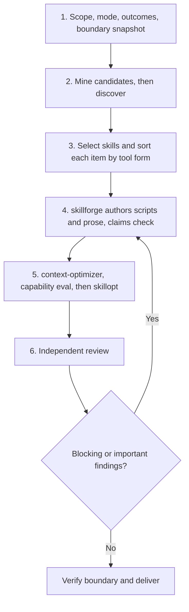

# Skill Bootstrap

> Build tools that build capability. Compute what can be computed; write
> prose only for what cannot. Measure each skill against a no-skill
> baseline. Report what you did not measure.

A bootstrap run turns a project's unwritten knowledge into skills an agent
depends on. Each piece of knowledge takes one of two **tool forms**:

| Form | Analogy | Ships as | Use for |
|---|---|---|---|
| **scaffold** | a map | prose the model reasons with | rationale, invariants, failure history, evidence bar, judgment calls |
| **instrument** | a GPS | a deterministic script in the skill's scripts directory | anything computable from repository state: gate lookups, path checks, counts, rankings |
| **both** | map plus GPS | script plus the prose that says why and where its answer stops | most load-bearing knowledge |

The goal is **capability**: what an agent achieves *with* the skill. It is
not competence without the tool. So every computable claim ships as a
script, and every skill gets a score with and without it. Installing this
skill does nothing; only an explicit request starts a run.

## Triggers

- `bootstrap skills`
- `capture project workflow knowledge`
- `build this repo's skill library`
- `project skill library`

## When Not To Use

| Request | Route |
|---|---|
| Create or improve one skill | `skillforge` |
| Save a workflow you just finished as a skill | `skillify` |
| Improve a skill against a scored eval set | `skillopt` |
| Decide placement or compress a skill without an eval | `context-optimizer` |
| Scaffold README or architecture templates | `codebase-documenter` |
| Refresh an existing library | This skill: run [drift](#maintenance-drift-loop), then pass each failing skill as `--update` |

## Prerequisites

`skillforge` (Phase 4) and `context-optimizer` (Phase 5) are required.
`skillopt` is optional (Phase 5); its `mine_sessions.py` is the session
source (Phase 2). Record each missing one as `UNAVAILABLE` in the report.

## Process



In the commands below, `<output-root>` is `.claude/skills` or `.github/skills`. Pass `--name` once per skill. On Windows
PowerShell, see [Scripts](#scripts).

### Phase 1: Scope, mode, outcomes, boundary

1. **First action:** run `git rev-parse --show-toplevel` and `git rev-parse HEAD`. List the skills under `.claude/skills/` and `.github/skills/`.
2. Find the audience and harnesses from the instruction files present, such as `AGENTS.md`, `CLAUDE.md`, and `.github/copilot-instructions.md`.
3. Select one `<output-root>`. If the repository generates skills from another source, such as a template directory, stop. Ask the user to choose one:
   - authorize the canonical paths, which you then pass to `verify` as `--also-allow <path>`; or
   - receive proposals only, with no skill files written.
4. Choose the **mode**:

   | Mode | Gate for a skill | Use when |
   |---|---|---|
   | `workflow` (default) | Verified friction: corrections, reverts, long review rounds | Agents lose time on known routes |
   | `knowledge` | A lens has verified content AND a frozen baseline case shows a model without the skill gets it wrong | Knowledge handoff: domain theory, architecture rationale, research method, with no friction record yet |

   Neither mode has a quota. A lens with no gate evidence gets no skill.
5. Choose 1 to 3 accepted outcomes (workflow) or the lenses to cover (knowledge). Ask the user first. If the user has none, take them from the Phase 2 `candidates` ranking. For each, write the observations that prove it meets project standards. A green check or a merged change is an intermediate result, not proof.
6. Respect explicit budgets. Ask at most five questions in total, and only for facts that evidence cannot supply.
7. Record the boundary before any write. Put the snapshot in the system temp directory or a session scratch directory, and keep the same path for Phase 6:

   ```bash
   python3 "${COPILOT_PLUGIN_ROOT:-${CLAUDE_PLUGIN_ROOT:-.claude}}/skills/skill-bootstrap/scripts/bootstrap_boundary.py" snapshot --repo . --output-root <output-root> --out "<snapshot path>"
   ```

**Authority.** Write only inside `<output-root>` and the paths the user authorized in step 3. The snapshot, plan, `bootstrap_mine.py --out` file, frozen eval cases file, eval cases, and eval results are the only writes outside the repository. Run no mutating git command, deployment, publication, tracker mutation, or platform-setting change. Evaluation grants no extra write authority. Modify an existing skill only when it is inside the boundary and passed with `--update`; otherwise compose it or report the proposed change.

### Phase 2: Mine candidates, then discover

1. Mine before you browse. The script ranks reverts, churn hotspots, TODO and FIXME hotspots, and (with `--prs-json` from the host API) review rounds. Exclude generated mirrors. When `reverts_truncated` is true, the scan stopped at `--max-commits` (default 3000); raise it to read older history:

   ```bash
   python3 "${COPILOT_PLUGIN_ROOT:-${CLAUDE_PLUGIN_ROOT:-.claude}}/skills/skill-bootstrap/scripts/bootstrap_mine.py" candidates --repo . --top 10 --exclude <generated-prefix>
   ```

2. Follow [references/discovery.md](references/discovery.md) from the mined cases: repository and discourse, the 16 discovery lenses, workflow gaps, and session and memory sources. When an outcome touches PRs, pipelines, trackers, or releases, also follow [references/hosted-platforms.md](references/hosted-platforms.md). Finish discovery before any authoring. In `knowledge` mode, freeze the baseline cases with `bootstrap_eval.py freeze` before the baseline run, so the hash covers them before any result exists.

### Phase 3: Select skills and sort by tool form

Decide per outcome or lens. `skillforge` triage in Phase 4 makes the final call; this choice is the proposal you give it.

| Evidence | Decision | Output |
|---|---|---|
| An existing skill reaches the outcome and no verified gap remains | Reuse | Report row only |
| Verified gap sits inside a skill within the boundary | Improve | `--update <skill>` |
| Two or more skills cover the outcome, but state is lost between them | Compose | One thin `<project>-<lens>` skill that sequences them |
| No skill covers the outcome and the mode's gate holds | Create | One `<project>-<lens>` skill |

Then sort every verified item by tool form and write the plan file (schema in [references/authoring-and-gates.md](references/authoring-and-gates.md#plan-file)). Ask one question per item: **can a program compute this from repository state?** If yes, it is `instrument` or `both`, never scaffold-only. Validate the plan, then names and conflicts:

```bash
python3 "${COPILOT_PLUGIN_ROOT:-${CLAUDE_PLUGIN_ROOT:-.claude}}/skills/skill-bootstrap/scripts/bootstrap_forms.py" check --plan "<plan path>"
python3 "${COPILOT_PLUGIN_ROOT:-${CLAUDE_PLUGIN_ROOT:-.claude}}/skills/skill-bootstrap/scripts/bootstrap_boundary.py" plan --repo . --output-root <output-root> --project <project> --name <project>-<lens>
```

To improve an existing skill, pass it twice: `--name <skill> --update <skill>`. Exit code 1 from either command means a violation, a conflict, or an invalid name: fix the plan, rename, get authorization for `--update`, or drop the skill. Never overwrite blindly.

### Phase 4: Author through skillforge

Invoke `skillforge` once per selected skill with the brief in [references/authoring-and-gates.md](references/authoring-and-gates.md). Every `instrument` or `both` item ships its script and tests; every skill ships `reverify.json`. Run independent skills in parallel agents when the harness supports it. If `skillforge` is unavailable, report `skillforge: UNAVAILABLE` and stop authoring. After authoring, prove the scripts exist and the text is grounded:

```bash
python3 "${COPILOT_PLUGIN_ROOT:-${CLAUDE_PLUGIN_ROOT:-.claude}}/skills/skill-bootstrap/scripts/bootstrap_forms.py" check --plan "<plan path>" --skills-root <output-root> --require-scripts
python3 "${COPILOT_PLUGIN_ROOT:-${CLAUDE_PLUGIN_ROOT:-.claude}}/skills/skill-bootstrap/scripts/bootstrap_mine.py" claims --repo . --authored <output-root>/<new-skill> <output-root>/<new-skill>
```

Pass each skill this run wrote or updated with `--authored`, so its uncommitted files count. A `claims` finding with context `current` is a defect to fix. A `historical` one is a hint: read the line and decide.

### Phase 5: context-optimizer, capability eval, then skillopt

1. Run `context-optimizer` on each authored skill and its composition. If it is unavailable, report `context-optimizer: UNAVAILABLE` and `skillopt: NOT RUN`.
2. Build and run the capability eval, per [references/authoring-and-gates.md](references/authoring-and-gates.md#capability-eval). Score against the same frozen file that was frozen before the knowledge-mode baseline run (for any other mode, freeze before the first run). Run each case without the skill (`baseline`) and with it (`with_skill`), then score:

   ```bash
   python3 "${COPILOT_PLUGIN_ROOT:-${CLAUDE_PLUGIN_ROOT:-.claude}}/skills/skill-bootstrap/scripts/bootstrap_eval.py" freeze --cases "<cases path>" --out "<frozen path>"
   python3 "${COPILOT_PLUGIN_ROOT:-${CLAUDE_PLUGIN_ROOT:-.claude}}/skills/skill-bootstrap/scripts/bootstrap_eval.py" score --frozen "<frozen path>" --results "<results path>"
   ```

   A skill whose cases are all `no_gap` adds nothing measurable: drop it or report why it stays. A `regression` is a blocking finding. In `knowledge` mode, add `--mode knowledge` to `score`: a skill whose cases are all `no_gap` then also exits 1, with its cases in `failing_cases`. A regex result that times out is left ungraded, so its case is `incomplete`.
3. Run `skillopt` only after steps 1 and 2, on the frozen cases as its held-out set. Otherwise report `skillopt: NOT RUN` with the missing input. Never invent an optimization result.

### Phase 6: Review, verify, and deliver

1. Run the three independent reviews in [references/authoring-and-gates.md](references/authoring-and-gates.md#review). Self-authored approval is not review evidence.
2. Send blocking and important fixes back through Phase 4 and Phase 5.
3. Prove provenance holds, then prove the boundary held, with the same snapshot path:

   ```bash
   python3 "${COPILOT_PLUGIN_ROOT:-${CLAUDE_PLUGIN_ROOT:-.claude}}/skills/skill-bootstrap/scripts/bootstrap_drift.py" check --repo . --skills-root <output-root> --name <new-skill> --require
   python3 "${COPILOT_PLUGIN_ROOT:-${CLAUDE_PLUGIN_ROOT:-.claude}}/skills/skill-bootstrap/scripts/bootstrap_boundary.py" verify --repo . --snapshot "<snapshot path>" --output-root <output-root> --name <new-skill>
   ```

   Run the drift check without `--allow-commands` unless the user approved the argv list of each `command` check; a skill whose checks were all skipped reports `skipped`, which proves nothing.

   Add `--update <skill>` for each authorized improvement and `--also-allow <path>` for each path the user authorized in Phase 1. A file grant covers that exact path; end a directory grant with `/`.
4. Deliver the report defined in [references/authoring-and-gates.md](references/authoring-and-gates.md#bootstrap-report).

## Maintenance: drift loop

Skills decay as the repository moves. Run the drift check on a schedule, after a large merge, or before relying on a library you did not author:

```bash
python3 "${COPILOT_PLUGIN_ROOT:-${CLAUDE_PLUGIN_ROOT:-.claude}}/skills/skill-bootstrap/scripts/bootstrap_drift.py" check --repo . --skills-root <output-root>
```

Exit code 1 lists `update_candidates` and gives `update_args` as a JSON list of argv tokens. Pass those tokens as separate arguments to a new bootstrap run; never paste them into a shell string. A skill directory whose name is not kebab-case is reported `malformed` and is left out of `update_args`. For a library authored before `reverify.json` existed, run `bootstrap_mine.py claims` on it instead.

## Scripts

Every script uses only the Python standard library, prints JSON with an `examined` count, writes nothing inside the repository (`bootstrap_eval.py freeze` writes there only with `--allow-in-repo`; `bootstrap_mine.py --out` refuses an in-repo path with no override), and runs on Linux, macOS, and Windows. Exit code 0 means success. Exit code 1 means findings that need action. Exit code 2 is a configuration error. Exit code 3, used by `bootstrap_mine.py` and `bootstrap_boundary.py` only, means git is missing or failed, or a working-tree read or `--out` write failed; `bootstrap_mine.py` reports an unreadable input file as exit 2. `bootstrap_eval.py` reports a git or read failure as exit 2, and `bootstrap_drift.py` marks an unreadable `reverify.json` as `malformed` (exit 1).

| Script and subcommand | Phase | Computes |
|---|---|---|
| `bootstrap_mine.py candidates` | 2 | Ranked reverts, churn, TODO hotspots, review rounds |
| `bootstrap_mine.py claims` | 4, 6, drift | Repository paths and line references in skill text that are missing, untracked, or out of range, each labeled `current` or `historical` |
| `bootstrap_forms.py check` | 3, 4 | Plan violations: computable item without an instrument, script missing, scaffold without a reason |
| `bootstrap_eval.py freeze`, `score` | 5 | Hash-frozen cases; pass rate per condition, capability delta, `gain`, `no_gap`, `flat`, `regression`, `incomplete` |
| `bootstrap_drift.py check` | 6, drift | Each skill's `reverify.json` checks; `update_candidates` |
| `bootstrap_boundary.py plan`, `snapshot`, `verify` | 1, 3, 6 | Names and conflicts; the write boundary |

`bootstrap_boundary.py` detail: `plan` exits 1 on a conflict or an invalid name. `verify` exits 1 on a path outside the boundary, an existing skill changed without `--update`, an ignored file written in a skill (it would not ship), HEAD or branch moved, or index flags or `info/exclude` changed. Exit code 2 also covers an output root outside the allowed set; an output root, skill directory, or `--also-allow` path that git ignores; an `--also-allow` path outside the repository, under `.git`, or overlapping a skills root; a symlink in any of those paths; or a snapshot that already exists, is inside the repository, is unreadable, or is from another repository or output root. `verify` does not see gitignored files outside the output root, empty directories, other writes inside `.git/`, or tag, config, and push operations. It catches accidental writes by a cooperating run; it is not a sandbox. Only the Phase 1 snapshot counts, so `snapshot` refuses to overwrite an existing file. An unreadable file in the working tree stops `snapshot` with exit code 3 before any write.

`bootstrap_drift.py` runs a `command` check only with `--allow-commands`; review the argv first, because it executes repository code. The command gets no stdin, discarded output, and only `PATH`, `HOME`, and locale variables from the environment. Never pass `--allow-commands` in a job that holds secrets or runs on untrusted pull request content.

On Windows PowerShell 7, set the plugin root once, then run the same subcommands with `python`. The first non-empty value wins, as in the bash form:

```powershell
$root = @($env:COPILOT_PLUGIN_ROOT, $env:CLAUDE_PLUGIN_ROOT, '.claude') | Where-Object { $_ } | Select-Object -First 1
python "$root/skills/skill-bootstrap/scripts/bootstrap_boundary.py" snapshot --repo . --output-root <output-root> --out "<snapshot path>"
```

## Limits

- The instrument-first rule has not yet shown a capability gain. Run `20261017T164000Z-2e1e279c` found no F1 gain on T1 to T4 (T1 0.867 to 0.872; T2 to T4 stayed at 1.000) at 1.4x to 2.5x cost per run (the report is at `evals/skill-bootstrap-capability/reports/20261017T164000Z-2e1e279c/REPORT.md` in the rjmurillo/ai-agents repository, not in this skill). Untested hypotheses: reproducibility across runs, and repositories where ad hoc scripts are hard to write.
- Per-case `gain` and `regression` have no noise floor. Run each case at least twice and treat a single-run flip with suspicion.

## Anti-Patterns

| Avoid | Instead |
|---|---|
| One skill per lens to fill a quota | Author only where the mode's gate holds |
| Prose that asks the model to compute an answer | Ship the script; keep prose for why and for where the script's answer stops |
| Reporting capability `UNMEASURED` by default | Freeze cases and score with and without the skill |
| A skill with no `reverify.json` | Machine-checkable provenance, so drift is detected, not discovered |
| Copying a maintained procedure into a skill | Link to it; add only the hint that prevents a known wrong turn |
| A friction ledger, registry, or per-fact database | Put the lesson in the skill with a source reference |
| Writing generated skill copies when the repo renders from templates | Stop at Phase 1 step 3 and ask |
| Reporting a stage that never ran | Report `UNAVAILABLE` or `NOT RUN` with the reason |

## Extension Points

Add a discovery lens in `references/discovery.md`, the plan-file lens table in `references/authoring-and-gates.md`, and `bootstrap_forms.py`. Add a hosting provider section in `references/hosted-platforms.md`. Add a grader kind in `bootstrap_eval.py`. Add a check kind in `bootstrap_drift.py`. Change the report shape in `references/authoring-and-gates.md`.

## Verification

- [ ] Every selected skill names its mode gate evidence and the observations that prove its outcome.
- [ ] `bootstrap_mine.py candidates` ran before discovery, or the report says why not.
- [ ] `bootstrap_forms.py check` exited 0 on the final plan with `--require-scripts`: no computable item is scaffold-only.
- [ ] `bootstrap_mine.py claims` reports no `current` finding in authored skills.
- [ ] `bootstrap_eval.py score` ran on frozen cases; the report gives each skill's capability delta, and no case is `regression` or `incomplete`.
- [ ] `context-optimizer` ran before `skillopt`, or the report names the skipped stage.
- [ ] Independent factual, doctrine, and usability reviews ran on the final text.
- [ ] `bootstrap_drift.py check --require` and `bootstrap_boundary.py verify` exited 0. The verify examined count is above zero unless the run wrote only proposals.
- [ ] The report separates authored, evaluated, and installed states, and lists unmeasured results.
